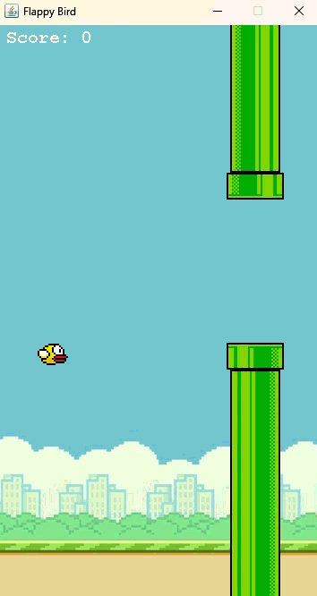
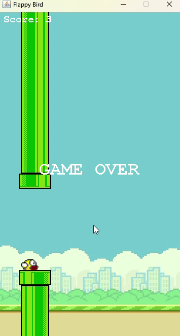

<div align="center">

# 🐤 Flappy Bird em Java

**Um clone do clássico Flappy Bird feito do zero com Java e Swing.**


<br/>

## 📸 Screenshots

<div align="center">
  
  &nbsp;&nbsp;&nbsp;&nbsp;
  
</div>


---

## 📖 Sobre o projeto

Este projeto recria o Flappy Bird usando apenas a biblioteca padrão do Java, sem frameworks nem engines de jogo. Ele nasceu como um exercício para praticar **programação orientada a objetos**, **interfaces gráficas** e **lógica de jogos**: game loop, gravidade, geração procedural de obstáculos e detecção de colisão.

O objetivo é simples: faça o pássaro passar pelos canos sem encostar neles e sem cair no chão. Cada par de canos ultrapassado vale **1 ponto**.

## ✨ Funcionalidades

- 🎮 Controle com a barra de espaço
- 🧱 Canos gerados automaticamente, com altura da abertura aleatória
- 💥 Detecção de colisão entre o pássaro e os canos
- 🏆 Placar em tempo real
- ☠️ Tela de **GAME OVER** e reinício instantâneo
- 🖼️ Visual pixel art com sprites e cenário próprios
- ⚡ Jogo rodando a aproximadamente 60 quadros por segundo

## 🎮 Como jogar

| Tecla | Ação |
|-------|------|
| `Espaço` | Faz o pássaro pular |
| `Espaço` (após o game over) | Reinicia a partida |

## 🚀 Como executar

### Pré-requisitos

- [JDK 17 ou superior](https://adoptium.net/) instalado
- Git (opcional, para clonar o repositório)

### Pelo terminal

```bash
# 1. Clone o repositório
git clone https://github.com/jpedro-swe/NOME-DO-REPOSITORIO.git

# 2. Entre na pasta do código-fonte
cd NOME-DO-REPOSITORIO/src

# 3. Compile
javac App.java FlappyBird.java

# 4. Execute
java App
```

### Pelo VS Code

1. Instale o **Extension Pack for Java**.
2. Abra a pasta do projeto no VS Code.
3. Abra o arquivo `App.java` e clique em **Run** acima do método `main`.

> **Importante:** as imagens (`.png`) precisam ficar na mesma pasta dos arquivos `.java`. O código as carrega com `getResource`, então, se elas estiverem em outro lugar, o jogo não encontra os sprites.

## 🗂️ Estrutura do projeto

```
.
|── docs/
|   ├── gameplay.gif          # GIF do jogo em execução
|   ├── gameover.png          # Print da tela de game over
├── src/
│   ├── App.java            # Ponto de entrada: cria e configura a janela
│   ├── FlappyBird.java     # Lógica do jogo, desenho e controles
│   ├── flappybird.png      # Sprite do pássaro
│   ├── flappybirdbg.png    # Imagem de fundo
│   ├── toppipe.png         # Sprite do cano superior
│   └── bottompipe.png      # Sprite do cano inferior
├── .gitignore
└── README.md
```

## 🧠 Como funciona

### Game loop

Um `javax.swing.Timer` dispara cerca de 60 vezes por segundo. A cada disparo, o jogo atualiza as posições (`move()`) e redesenha a tela (`repaint()`).

```java
gameLoop = new Timer(1000 / 60, this);
```

### Física do pássaro

A cada quadro, a gravidade aumenta a velocidade vertical, e o pulo substitui essa velocidade por um valor negativo (para cima).

```java
VelocityY += gravity;   // gravidade acelera a queda
bird.y += VelocityY;    // atualiza a posição

// ao apertar espaço:
VelocityY = -9;         // impulso para cima
```

### Geração dos canos

Um segundo timer cria um par de canos a cada 1,5 segundo. A posição vertical é sorteada, e a abertura entre os canos tem sempre o mesmo tamanho, o que mantém o jogo justo.

### Colisão

A colisão usa o método clássico de sobreposição de retângulos (AABB):

```java
return a.x < b.x + b.width &&
       a.x + a.width > b.x &&
       a.y < b.y + b.height &&
       a.y + a.height > b.y;
```

## 🛠️ Tecnologias e conceitos

| Área | O que foi usado |
|------|-----------------|
| Linguagem | Java |
| Interface gráfica | Swing e AWT (`JFrame`, `JPanel`, `Graphics`) |
| Eventos | `ActionListener` e `KeyListener` |
| Estruturas de dados | `ArrayList` |
| Conceitos | POO, classes internas, game loop, detecção de colisão, números aleatórios |

## 🔮 Próximos passos

- [ ] Salvar a maior pontuação (recorde) em arquivo
- [ ] Efeitos sonoros para pulo, pontuação e colisão
- [ ] Animação das asas do pássaro
- [ ] Tela inicial com menu
- [ ] Dificuldade progressiva (canos mais rápidos conforme a pontuação)
- [ ] Fonte pixel art (Press Start 2P) na interface

## 🤝 Contribuindo

Sugestões e melhorias são bem-vindas:

1. Faça um fork do projeto
2. Crie uma branch para sua alteração (`git checkout -b minha-melhoria`)
3. Faça o commit (`git commit -m "Adiciona minha melhoria"`)
4. Envie para o seu fork (`git push origin minha-melhoria`)
5. Abra um Pull Request

## 📄 Licença

Distribuído sob a licença MIT. Veja o arquivo `LICENSE` para mais informações.

## 👤 Autor

<div align="center">

**jpedro-swe**

[](https://github.com/jpedro-swe)

⭐ Se gostou do projeto, deixe uma estrela no repositório!

</div>